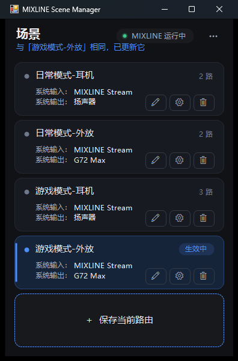
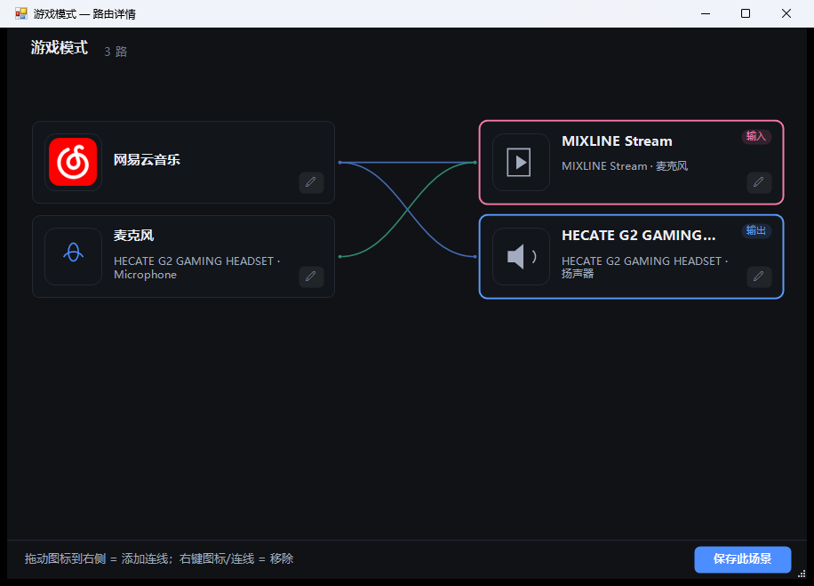

# MIXLINE Scene Manager

Logitech MIXLINE 的场景管理器：把当前音频路由保存成「场景」，之后一键切回。
**单 exe、无需安装、无 Node / 浏览器 / 第三方依赖**，界面为自绘深色 WinForms。

[](https://github.com/Raycoi/MIXLINE-Scene-Manager/actions/workflows/ci.yml)
[](https://github.com/Raycoi/MIXLINE-Scene-Manager/releases)



## 功能

- 读取 MIXLINE 当前路由（设备连线、静音状态）
- 把当前路由保存为场景，支持重命名、删除、覆盖
- 一键切换场景：对比差异 → 增删连线 → 校验
- 每个场景可绑定 Windows 默认输入/输出设备
- 设备别名（只改显示名，不改系统设备名）
- 顶部实时显示 MIXLINE 运行状态
- 可选择「用本程序替换 MIXLINE 界面」，从 MIXLINE 托盘打开本程序
- 自定义窗口位置、行高、日志级别



## 权限要求

> **⚠ 本程序需要以管理员权限运行。**
>
> `app.manifest` 使用 `requireAdministrator`。未签名的小工具在部分杀软（如火绒 HIPS）
> 或系统沙箱下会以低完整性级别运行，无法写入配置目录，也无法正常调起资源管理器。
> 以管理员权限运行可以避开这类限制。
>
> UAC 关闭时双击即管理员；UAC 开启时会弹一次确认。

## 运行

1. 安装 .NET Framework 4.8（Windows 10/11 通常自带）
2. 双击 `MIXLINE Scene Manager.exe`
3. 首次运行会在 exe 同目录的 `MSM-data` 下创建 `MSM-config.json`

也可以从 [Releases](https://github.com/Raycoi/MIXLINE-Scene-Manager/releases) 下载打包好的 zip。

## 构建

需要 Windows + .NET Framework 4.8（使用系统自带的 `csc.exe`，不需要 MSBuild / NuGet）：

```bat
build.cmd
```

产物：

```
bin\MIXLINE Scene Manager.exe
bin\MIXLINE Scene Manager.exe.config
```

## 测试

离线单元测试，不连接 MIXLINE 引擎，配置读写在临时目录进行：

```bat
tests\run-tests.cmd
```

## 配置

- 默认位置：`<exe 目录>\MSM-data\MSM-config.json`
- 可在「设置」中更改配置目录；写入失败时会自动迁移到用户可写目录
- `MSM-config.json` 含本机设备 ID / 别名，**不要提交到仓库**
- 窗口位置同时备份在 `%APPDATA%\MIXLINE Scene Manager\window-pos.txt`

## 项目结构

```
src/            主程序源码（Protocol / Storage / Views / Platform / Helpers / Infrastructure）
tests/          离线单元测试
docs/images/    界面截图
build.cmd       单文件编译脚本
app.manifest    DPI + requireAdministrator
.github/        CI / Release workflow
```

## 工作原理（简述）

- 通过本机 MIXLINE 的 gRPC 端点读取/修改路由
- 端点与令牌从注册表读取：`HKCU\Software\Logi\MIXLINE` 的 `Port` / `AccessToken`
- 手写 HTTP/2 (h2c) 帧与 HPACK 编码，无第三方 gRPC 库
- 切换场景时按「先加、再改音量、最后删」的顺序执行，降低切换过程中的断音

## 已知限制

- 固定路由（pinned）不参与切换
- 连线音量恢复为尽力而为
- MIXLINE 升级后若协议字段变化，可能需要更新字段号
- 仅在本机使用，不修改 Logitech 的安装文件或驱动

## 免责声明

本项目为个人使用的第三方工具，与 Logitech 无关联。使用前请自行评估风险。
